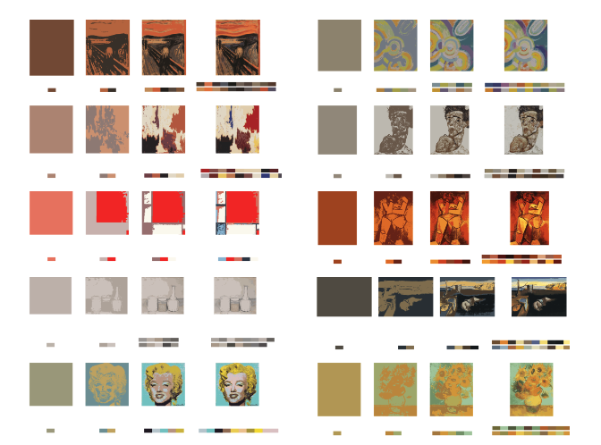
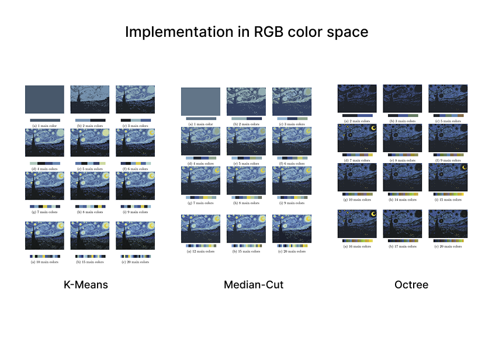
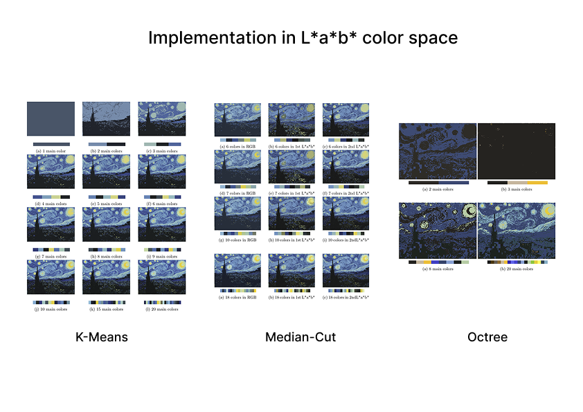

# 🎨 Finding Theme Color Palettes

Automatically extract theme color palettes from images of famous paintings using multiple color quantization algorithms in both **RGB** and **L\*a\*b\*** color spaces.  
This project evaluates visual fidelity using four objective image quality metrics and compares algorithmic performance.

  

---

## 📚 Table of Contents
- [Overview](#overview)
- [Features](#features)
- [Algorithms](#algorithms)
- [Image Quality Assessment](#image-quality-assessment)
- [Experimental Results](#experimental-results)

---

## 📘 Overview

Color palettes derived automatically from images can support real applications in **fashion coordination**, **interior design**, **UI design**, and more.  
This project provides a systematic comparison of color quantization approaches, helping both designers and non-experts better understand and generate high-quality palettes.

We analyze palette extraction using:

- Three quantization algorithms  
- Two color spaces (RGB, L\*a\*b\*)  
- Four objective metrics for fidelity  

---

## ✨ Features

- Extract theme color palettes from any input image  
- Quantize images using:
  - K-Means  
  - Median-Cut  
  - Octree  
- Evaluate quantized images using **PSNR**, **SSIM**, **VIF**, and **GMSD**  
- Compare algorithm performance across **RGB** and **L\*a\*b\*** spaces  
- Visualize original vs. quantized images and extracted palettes  

---

## 🧮 Algorithms

### 1. **K-Means Clustering**
A clustering-based algorithm using Euclidean distance, effective in both RGB and L\*a\*b\* spaces.  
Produces the most stable and visually faithful palettes among the tested methods.

### 2. **Median-Cut**
Recursively splits the color space along its longest dimension at the median value.  
Commonly used in image compression and palette creation.

### 3. **Octree Quantization**
Builds a hierarchical tree structure to group and merge similar colors.  
Efficient for large images and 3D color data.

  

  

---

## 🧪 Image Quality Assessment

We evaluate visual fidelity using four standard IQA metrics:

- **PSNR** — Measures pixel-level error  
- **SSIM** — Captures structural similarity from a perceptual viewpoint  
- **VIF** — Measures shared visual information between reference and quantized images  
- **GMSD** — Compares gradient magnitude, reflecting human sensitivity to local structure  

---

## 📊 Experimental Results

Key findings from our experiments:

1. **K-Means achieves the highest overall performance**, both in objective metrics and human visual evaluations.  
2. **L\*a\*b\*** color space consistently yields **higher fidelity scores** than RGB, confirming its perceptual advantages.  
3. Palette appearance varies significantly across algorithms due to differing clustering strategies.  
